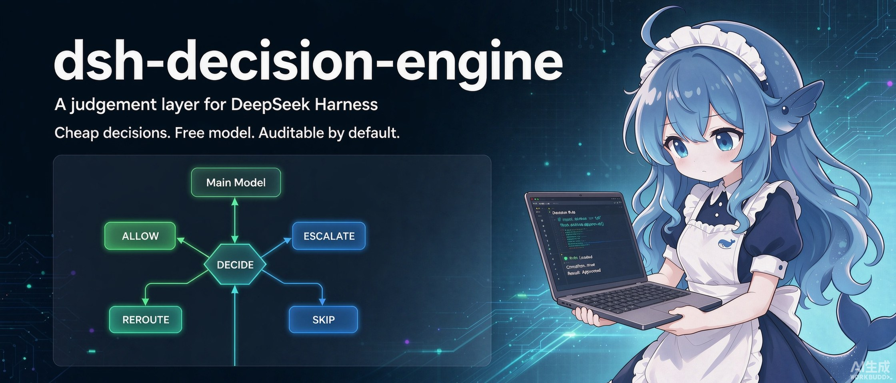

# dsh-decision-engine

**Free decision model provided**

[简体中文](./README.zh.md)

A judgement layer for DeepSeek Harness that does one thing: it takes "should this happen, is it worth it, which one" away from the main model and hands it to a decision model that is far cheaper. A free decision model ships with the plugin — a fresh install is already using it, with no key, no cost and no routes to configure.

## 1. A cheap small model replaces letting the LLM decide everything

The main model spends its most expensive tokens on its cheapest judgements: may this tool call proceed, is this step worth the strong model, should the context be compacted now. The answers are usually just "yes / no / which one", yet answering them means re-reading the whole session history.

The decision model answers exactly those questions: it reads a trimmed-down state and returns a structured verdict — allow, escalate, reroute to a cheaper model, or skip the call entirely. The cost is a fraction of the main model re-reading its own context. The clearest case is tool authorization: it replaces auto-review, which sends the full session history to the main model on every tool call — roughly 60k tokens each time.

The free decision model is on by default for fresh installs; any other service exposing a decision endpoint can be plugged in instead — built-in presets, or your own base URL.

Provider definitions live in [`lib/providers.json`](./lib/providers.json): one object per provider, each with its base URL, endpoint style, key field and a `models` array listing the models that service can use (an empty array means "let the service decide"). Each entry in `models` can be a plain string or an object `{ "id": "...", "capabilities": { ... } }`. To add a preset provider, edit this file and submit a PR.

Different endpoints — and even different models from the same endpoint — accept different request fields, so capabilities can be declared at both levels. A provider carries a `capabilities` table (for example `{ "thinkMode": false }` for `decisionmodels.io`, which rejects `think_mode` with HTTP 400), and an individual model can override any of those keys: `{ "id": "s1-pro", "capabilities": { "maxQuestions": 3 } }` overrides the provider's `maxQuestions: 1`. Model values win over provider values, and protocol facts win over both (a protocol with no `think_mode` field can't claim one). The configuration UI and the request builder both read the merged table for the **selected model**, so a control is disabled whenever that model would ignore it — no more "set it and nothing happens". Adding a capability is a JSON edit — the UI needs no change.

Presets ship for System One-compatible services (TypeSafe, SiliconFlow, Intern InkStone, Decision Models, or your own llama.cpp / vLLM), Google AI Studio Decisions, and OpenAI Decisions. Wire protocols differ — `protocol` in the JSON selects one: `systemone` (the generic `state` + `questions` shape), `google-decisions`, or `openai-decisions` (`POST /v1/decisions` with an `input` / `questions` array and `answers` returned as a named array). Request body, auth header and answer shape for a protocol all live in [`lib/wire-protocol.js`](./lib/wire-protocol.js), so a new protocol is one module plus one JSON entry.

## 2. Which model a subagent uses, and how hard it thinks, is decided by the decision model

DeepSeek Harness gives a spawned subagent the exact same provider, model and reasoning effort as the lead. That default only holds when the lead is doing the same kind of work itself: sending a research subtask to the lead's strong model is pure waste, and pushing a high-fidelity refactor down to a cheap tier buys a rewrite.

This plugin replaces that default. **On each spawn, the decision model picks the model in a `choice` question over the candidate routes, then picks the reasoning effort from what that model actually publishes.**

- **Candidates are routes you already have.** They come from the session's `subagent/model-selection-policy` (the routes you authorized for subagents in DSH settings), falling back to the live `llm` adapter catalogue. There is nothing new to configure in this plugin.
- **Inheriting the lead stays on the table** (and is labelled as such), so "just use what I'm using" is a valid answer rather than a forced switch.
- **Effort follows the target model's published `efforts`.** If it publishes none, the field is omitted rather than guessed — a guessed id fails the child spawn outright.
- **Explicit choice wins.** A `provider`/`model` passed in the delegation call, or set with `set_model`, outranks the automatic judgement.

## 3. The rest of the harness's behaviour is decided the same way

The same mechanism covers the harness's other judgements: model routing (mechanical steps downshift to a cheaper model), subtask delegation (continue inline, spawn a subagent, or form a team), context compaction (summarize, or just drop stale tool results), turn continuation, retrieval necessity, skill selection, and the COT translation gate.

Each decision point has its own three-state switch: off · observe · enforce. Only tool authorization is on out of the box (in observe, recording without blocking); the rest you turn on as you want them. Any error, timeout or malformed answer fails open and lets the call through: the decision model must never be the reason a tool call gets stuck.

## 4. The free model can also be a fallback, not just a primary

The free model above is normally either your primary decision model or unused. There is a third role: **keep your own provider as primary, and switch to the free model only when it fails.** Turn on "free-model fallback" and any 4xx (429 insufficient balance, 402 out of credit, 401/403 bad key) or 5xx from your provider — plus a 200 with an unusable body — makes that one call retry on the free model instead of degrading. Timeouts and network errors are deliberately excluded: they already have their own cold-start retry, and re-issuing them elsewhere only stretches the worst-case wait. Off by default, since it makes the plugin fetch the free-model config ahead of time and can add one request on failure.

## License

MIT
