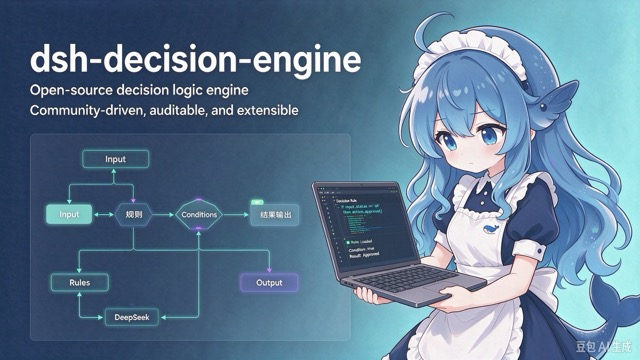
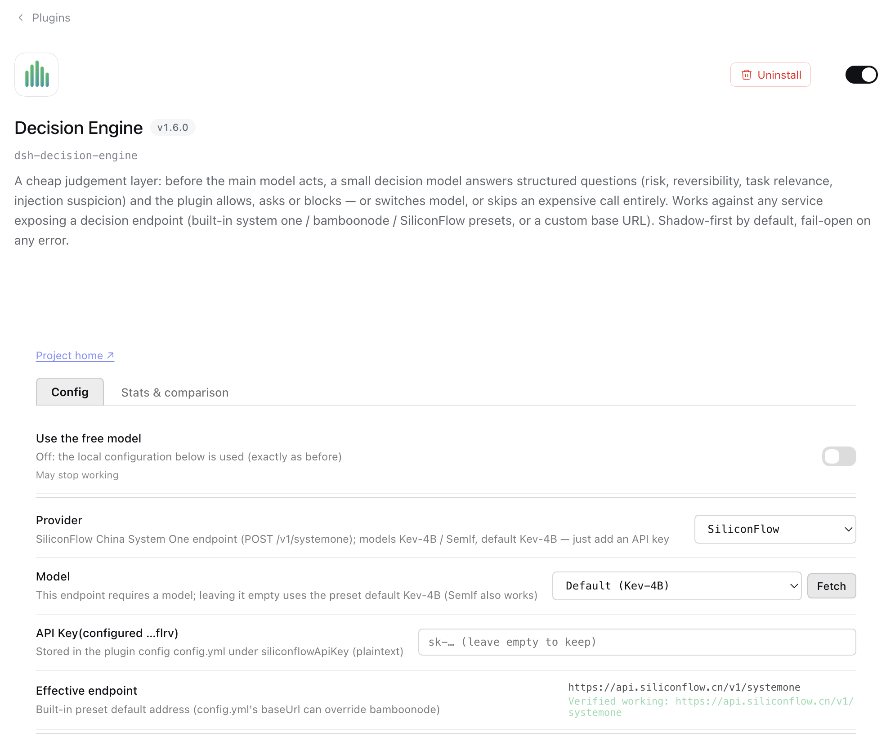
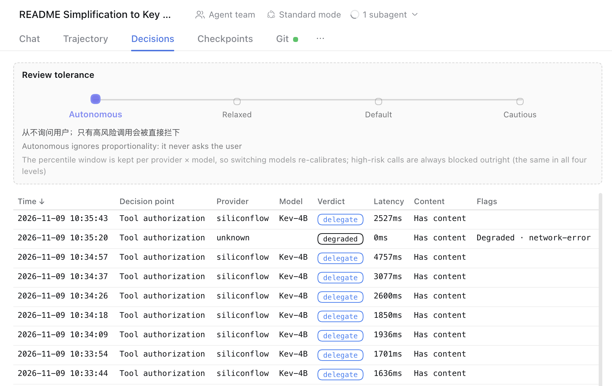

# dsh-decision-engine

[website](https://dsh.zuos.us/dsh-decision-engine/) ·
[config.example.yml](config.example.yml) · [DECISIONS.md](DECISIONS.md)

给 DeepSeek Harness 的决策层：主模型动手之前，用一个便宜的决策小模型做结构化判断。
A judgement layer for DeepSeek Harness: a cheap decision model judges before the main model acts.

## 功能 / Features

**八个决策点 / Eight decision points**

- 工具授权 / tool authorization
- 模型路由 / model routing
- 子任务分派 / delegation
- 上下文压缩 / compaction
- 轮次延续 / turn continuation
- 检索必要性 / retrieval necessity
- 技能选择 / skill selection
- 思维链翻译 / COT translation gate

**三态 / Modes**：关闭 off · 观察 observe · 生效 enforce

**决策服务 / Providers**：system one · bamboonode · 硅基流动 SiliconFlow（国内 / 国际）·
Perplexity · OpenRouter · custom base URL

**人工审核比例 / Review tolerance**：自治 autonomous · 轻松 relaxed · 默认 default ·
谨慎 cautious

**界面 / UI**：决策历史标签页 / Decisions tab · 配置页 / config page · 统计与对比 / stats ·
审批卡正文可读化 / readable approval card

| 配置页 / Config page | 决策历史 / Decisions tab |
|---|---|
|  |  |

**省 token / Token saving**：精确缓存 / exact cache · 只读工具放行 / read-only tools bypass ·
state 截断 / state trimming

**可靠性 / Reliability**：默认只记录不拦截 / shadow by default · 任何异常 fail-open 放行 /
fail open on any error · 超时降级 / timeout degrades · 匿名统计可关 / stats can be turned off

## License

MIT
