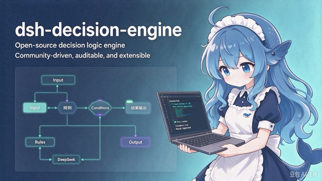
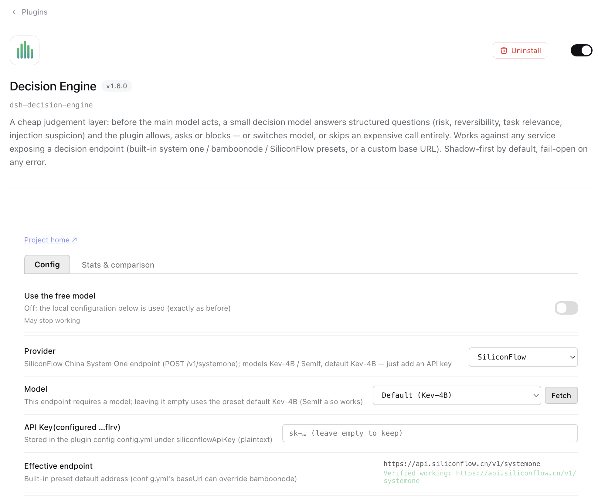
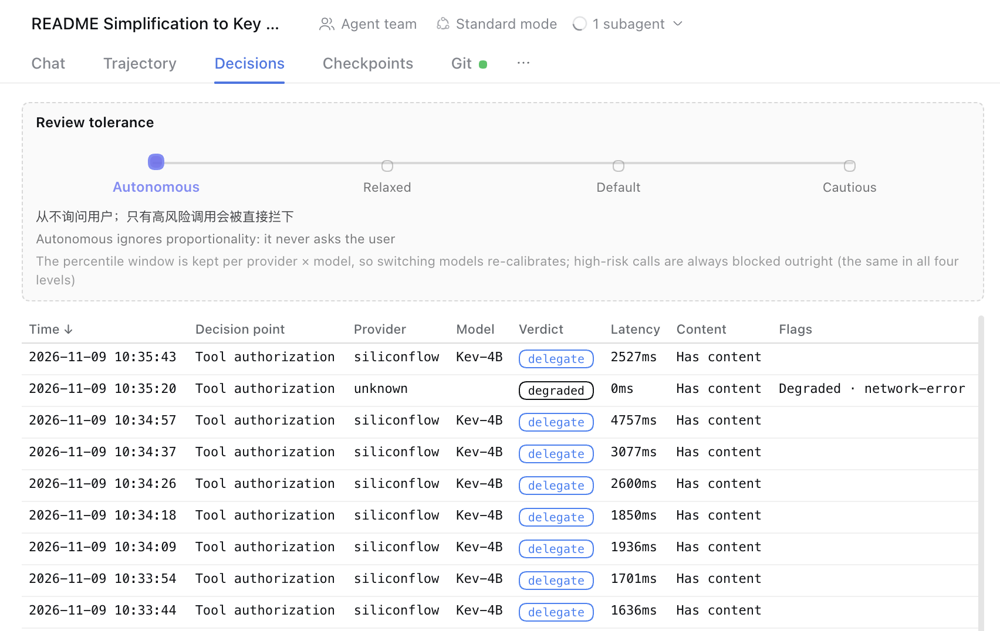

# dsh-decision-engine

**提供免费决策模型**

[网站](https://dsh.zuos.us/dsh-decision-engine/) ·
[config.example.yml](config.example.yml) · [DECISIONS.md](DECISIONS.md)

[English](./README.md)

给 DeepSeek Harness 的决策层：主模型动手之前，用一个便宜的决策小模型做结构化判断。

## 功能

**八个决策点**

- 工具授权
- 模型路由
- 子任务分派
- 上下文压缩
- 轮次延续
- 检索必要性
- 技能选择
- 思维链翻译

**三态**：关闭 · 观察 · 生效

**决策服务**：system one · bamboonode · 硅基流动 SiliconFlow（国内 / 国际）·
Perplexity · OpenRouter · 自定义 base URL

**人工审核比例**：自治 · 轻松 · 默认 · 谨慎

**界面**：配置页（四个可折叠分组）· 决策历史标签页 · 统计与对比 ·
审批卡正文可读化

| 配置页 | 决策历史 |
|---|---|
|  |  |

> 截图拍于分组折叠（DEC-051）之前的版式，当前界面为四个可折叠分组。

**省 token**：精确缓存 · 只读工具放行 · state 截断

**可靠性**：默认只记录不拦截 · 任何异常 fail-open 放行 · 超时降级 ·
匿名统计可关

## 许可证

MIT
