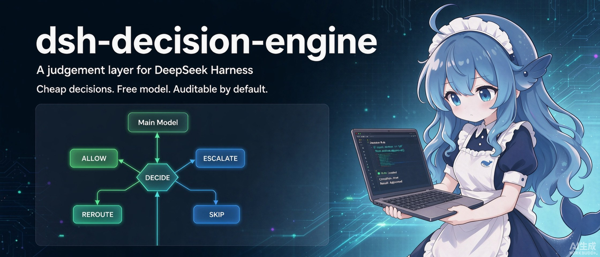

# dsh-decision-engine

**提供免费决策模型**

[English](./README.md)

给 DeepSeek Harness 的决策层，只做一件事：把「该不该、值不值、用哪个」这类判断从主模型手里拿走，交给一个便宜得多的决策小模型。全新安装默认带一个免费决策模型——不花钱、不用配 key、不用配路由。

## 1. 便宜的小模型，取代「什么都由 LLM 决定」

主模型每一步都在用最贵的钱做最便宜的判断：这次工具调用能不能放行、这一步值不值得用强模型、现在该不该压缩上下文。这些判断的答案往往只是「是 / 否 / 选哪个」，但让主模型来答，它得先把整个会话历史重读一遍。

决策模型答的就是这些题：只读被裁到最小的 state，输出结构化裁决——放行、升级询问、换成更便宜的模型、或者干脆跳过这次调用。成本是主模型重读上下文的零头。最典型的一处是工具授权：它替代 auto-review，而后者每次工具调用都要把完整会话历史发给主模型，一次约 60k token。

插件自带免费决策模型，全新安装默认已开启；也可以换成任何提供决策端点的服务——内置多家预设，或填自定义 base URL。

provider 定义都在 [`lib/providers.json`](./lib/providers.json)：一个 provider 一个对象，写明地址、端点风格、密钥字段，以及 `models` 数组（该服务可用的模型；空数组表示交给服务端决定）。想要增加预设 provider，修改这个文件后发 PR 即可。

不同端点接受的请求字段不同，因此每个预设带一张 `capabilities` 能力表（例如 `decisionmodels.io` 写 `{ "thinkMode": false }`——它会对 `think_mode` 回 400）。配置界面按这张表把对应的控件禁用并说明原因，而不是给出一个「选了也不生效」的选项。新增一种能力只需要改 JSON，界面不用动。

内置预设覆盖三类服务：System One 兼容端点（TypeSafe、硅基流动、书生·端砚、Decision Models，以及自建 llama.cpp / vLLM）、Google AI Studio Decisions、OpenAI Decisions。三者的**线协议不同**，由 JSON 里的 `protocol` 选择：`systemone`（通用的 `state` + `questions` 形状）、`google-decisions`、`openai-decisions`（`POST /v1/decisions`，请求用 `input` / `questions` 数组，答案以带 `name` 的数组返回）。每种协议的请求体、鉴权头与答案形状都在 [`lib/wire-protocol.js`](./lib/wire-protocol.js) 里——新增一种协议 = 一个模块 + 一条 JSON。

## 2. 子代理用哪个模型、多强的推理，由决策模型决定

DSH 默认让派生出的 subagent 原样继承 lead 的 provider / model / 推理强度。这个默认值只在「lead 自己也在做同类工作」时成立：把调研类子任务交给 lead 的强模型是纯浪费，把要求高保真的重构下沉到便宜档换来的是返工。

本插件换掉了这个默认值：**派生 subagent 时，决策模型在候选路由里做一道 choice 题选出模型，再按该模型自己公布的能力选推理强度。**

- **候选就是你已有的路由。** 取自会话的 `subagent/model-selection-policy`（你在 DSH 设置里授权给子代理的那批），拿不到时回退到 `llm` 适配器的真实目录。本插件里没有任何新路由要你填。
- **「继承 lead」永远在选项里**（并明确标注），所以「就用现在这个」是合法答案，而不是被迫切换。
- **推理强度按目标模型公布的清单取**；它不公布就省略该字段，而不是猜一个——猜错的 id 会让子代理派生直接失败。
- **显式选择优先级最高。** 派生调用里直接传的 `provider`/`model`，或用 `set_model` 指定的，都高于自动判断。

## 3. 其余 harness 行为，也交给它判断

同一套机制覆盖 harness 的其他判断：模型路由（机械步骤下沉到便宜档）、子任务分派（自己做 / 开 subagent / 组队）、上下文压缩（摘要压缩还是只丢陈旧工具结果）、轮次延续、检索必要性、技能选择、思维链翻译门槛。

每个决策点独立三态：关闭 · 观察 · 生效。默认只开了工具授权（观察态，只记录不拦截），其余按需打开。任何异常、超时、答案形状不符都 fail-open 放行——决策模型永远不该成为卡住工具调用的原因。

## 4. 免费模型也可以只当兜底，而不是主模型

上面那个免费模型平时要么当主模型、要么不用。现在还有第三种用法：**主模型仍是你自己配的那家，只在它出错时改用免费模型。** 打开「免费模型兜底」后，主模型返回任何 4xx（429 额度不足、402 欠费、401/403 key 失效）或 5xx，以及 200 但响应体不可用时，**那一次调用**会自动改用免费模型再问一遍，而不是直接降级放行。超时与网络错误刻意不在其列：它们本就有一套专门的冷启动重试，换一家重发只会把最坏等待拉得更长。默认关闭——它要求插件提前去取免费配置，并可能在失败时多打一次请求。

## 许可证

MIT
